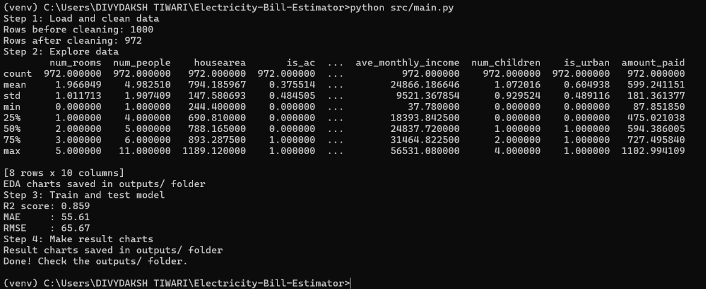
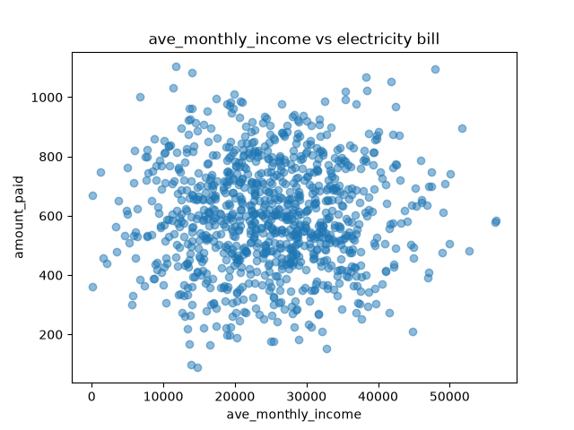
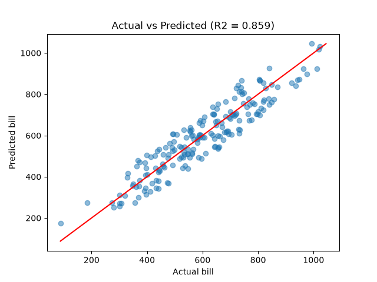

# ⚡ Electricity Bill Estimator

Predicts monthly household electricity bills using multiple linear regression based on house area, occupancy, and appliance indicators (`pandas`, `matplotlib`, `scikit-learn`).

   

---

## 👥 Team and Roles

| Member           | Entry No.   | Role               | GitHub Handle   |
| ---------------- | ----------- | ------------------ | --------------- |
| DIVYDAKSH-TIWARI | 2026DAB1292 | Documentation lead | [FILL: @handle] |
| ASHUTOSH-KUMAR   | 2026AIB1023 | Execution lead     | [FILL: @handle] |
| K.N. PRAYOG      | 2026EEB1361 | PPT lead           | [FILL: @handle] |
| GOKUL-GARG       | 2026MCB1526 | Video lead         | [FILL: @handle] |

*All four members contributed code (see commit history).*

---

## 🚀 Project Overview

Household electricity bills depend on factors such as house size, the number of people living in the house, and the appliances in use. This project builds a machine learning model that predicts the monthly electricity bill of a household from these factors.

---

## 📌 Problem Statement

Households often cannot estimate their upcoming electricity bill, which makes budgeting and energy planning difficult. The objective of this project is to develop a regression model that predicts the monthly bill from house area, occupancy and appliance data, so a user can get a quick, data-driven estimate.

---

## 🎯 Objectives

- Load and clean a household energy dataset.
- Explore the data visually (EDA) to understand which factors affect the bill.
- Train a multiple linear regression model.
- Evaluate the model using standard regression metrics.
- Provide a script that predicts the bill for a new house.

---

## 📂 Dataset Description

| Attribute       | Description                                           |
| --------------- | ----------------------------------------------------- |
| File            | `data/household_energy_bill_data.csv`                 |
| Source          | [FILL: where the dataset came from, e.g. Kaggle link] |
| Rows            | [FILL: number of rows]                                |
| Columns         | [FILL: number of columns]                             |
| Target Variable | [FILL: name of the bill column]                       |
| Input Features  | House area, occupants, appliance indicators           |
| Learning Task   | Regression (multiple linear regression)               |

The dataset is included in this repository, so no separate download is needed.

---

## 🔄 Project Workflow

```
Raw CSV Data
     |
     ↓
Data Cleaning (data_cleaning.py)
     |
     ↓
Exploratory Data Analysis (eda.py)
     |
     ↓
Model Training and Evaluation (train_model.py)
     |
     ↓
Result Plots (result_plots.py)
     |
     ↓
Bill Prediction for a New House (predict.py)
```

---

## 📁 Repository Structure

```
Electricity-Bill-Estimator/
├── data/
│   └── household_energy_bill_data.csv   # dataset
├── src/
│   ├── main.py            # runs all steps (entry point)
│   ├── data_cleaning.py   # loads and cleans the data
│   ├── eda.py             # data charts
│   ├── train_model.py     # trains the model and checks accuracy
│   ├── result_plots.py    # result charts
│   └── predict.py         # predicts the bill for a new house
├── outputs/               # charts, metrics.txt and the saved model
├── requirements.txt       # libraries to install (pinned versions)
└── README.md
```

### Folder Description

| Folder/File        | Purpose                                         |
| ------------------ | ----------------------------------------------- |
| `data/`            | Contains the dataset                            |
| `src/`             | Contains the project source code                |
| `outputs/`         | Stores charts, `metrics.txt` and the saved model |
| `requirements.txt` | Lists required Python libraries (pinned)        |
| `README.md`        | Project documentation                           |

---

## 🛠️ Technologies Used

### Programming Language

- Python

### Data Processing

- Pandas
- NumPy

### Machine Learning

- Scikit-learn

### Data Visualization

- Matplotlib

### Development Tools

- VS Code
- Git & GitHub

---

## ⚙️ Installation & Setup

Tested on Python [3.14] (Windows).

Follow the steps below to run this project locally.

### 1. Clone the Repository

```bash
git clone https://github.com/2026dab1292-maker/Electricity-Bill-Estimator.git
cd Electricity-Bill-Estimator
```

### 2. Create a Virtual Environment

```bash
python -m venv venv
```

### 3. Activate the Environment

```bash
# Windows
venv\Scripts\activate

# macOS / Linux
source venv/bin/activate
```

### 4. Install Dependencies

```bash
python -m pip install -r requirements.txt
```

All library versions are pinned in `requirements.txt`, and all file paths in the code are relative.


### 5. Run the Full Pipeline

```bash
python src/main.py
```

This cleans the data, creates the EDA charts, trains and evaluates the model, and saves the result plots.

## 📸 Expected Output after running `python src/main.py`



Running `python src/main.py` produces outputs in `outputs/`

Files saved in `outputs/`:

- `metrics.txt`: model accuracy metrics

-images(png) of the scatter plots and histograms
for eg:  
- the saved trained model

---

## 📈 Model Performance Results

| Metric        | Value                    |
| ------------- | ------------------------ |
| R² (test set) | [FILL: from metrics.txt] |
| MAE           | [FILL: from metrics.txt] |
| RMSE          | [FILL: from metrics.txt] |

**Observation:** [FILL: 1-2 lines, e.g. "The bill increases with house area and the number of appliances; the model explains X% of the variation."]

### Results Visualization



---

## 🔮 Prediction Demo

The trained model predicts the bill for a new house:

```
House details (area, occupants, appliances)
        |
        ↓
Saved trained model
        |
        ↓
Predicted monthly bill
```

Run:

```bash
python src/predict.py
```

---

## 🔗 Links

- 📑 Slides (5): [FILL: docs/Team_slides.pdf or drive link]
- 🎥 Video (max 5 min): [FILL: unlisted YouTube or Drive link]

---

## ✅ What Worked and What Didn't

- **Worked:** [FILL: e.g. linear regression gave a good fit on this data]
- **Didn't / limitations:** [FILL: e.g. dataset is small; a linear model cannot capture non-linear effects]

---

## 🚀 Future Improvements

- Try other models such as Random Forest or Gradient Boosting and compare with linear regression.
- Add more features such as city, season, tariff slab and appliance wattage.
- Build a simple web app where a user enters house details and gets a bill estimate.
- Use cross-validation and hyperparameter tuning for more reliable results.

---

## 🤝 Contributions

| Member           | Contribution                                                       |
| ---------------- | ------------------------------------------------------------------ |
| DIVYDAKSH-TIWARI | [FILL: e.g. README, project structure, documentation]              |
| ASHUTOSH-KUMAR   | [FILL: e.g. requirements.txt, run steps, fresh-clone testing]     |
| K.N. PRAYOG      | [FILL: e.g. EDA and result plots, 5-slide PPT]                     |
| GOKUL-GARG       | [FILL: e.g. model training, demo video]                            |

---

## 🤖 AI-use Disclosure

- Claude: drafted the first version of this README; edited and verified by Divydaksh.
- [FILL: add one line per other tool, e.g. ChatGPT: fixed an error in src/eda.py; we tested the fix.]
- No AI was used to generate the dataset or the results.

---

## 📄 License

This project was created for educational purposes as part of the AI101 mini-project at IIT Ropar.
